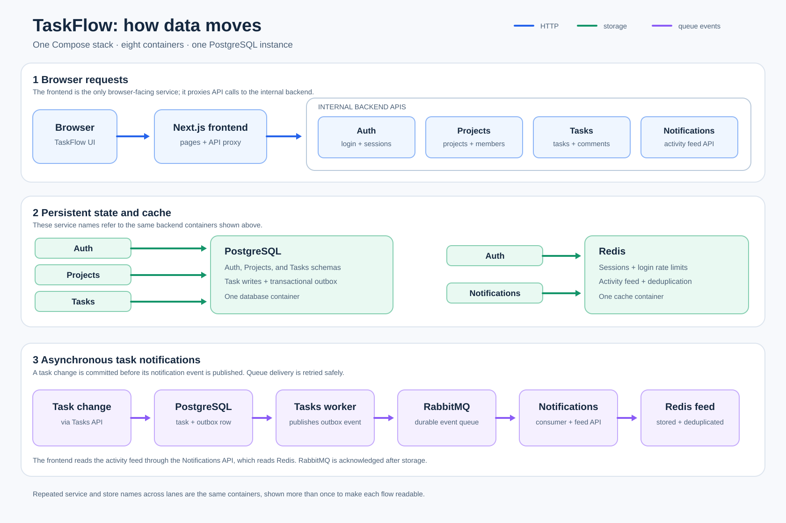
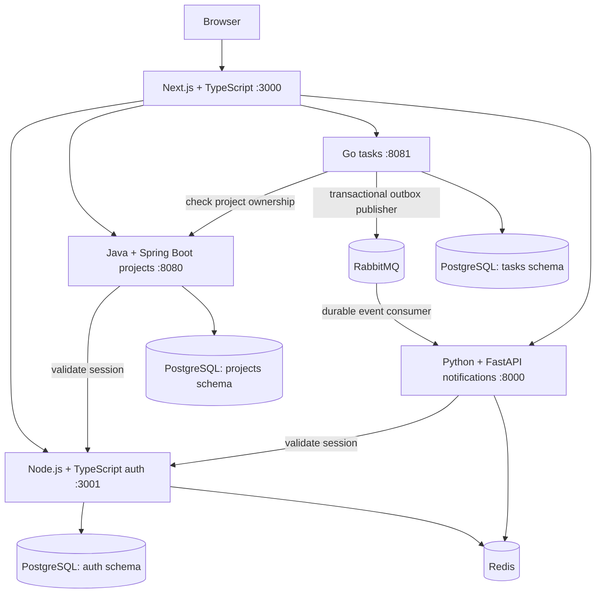
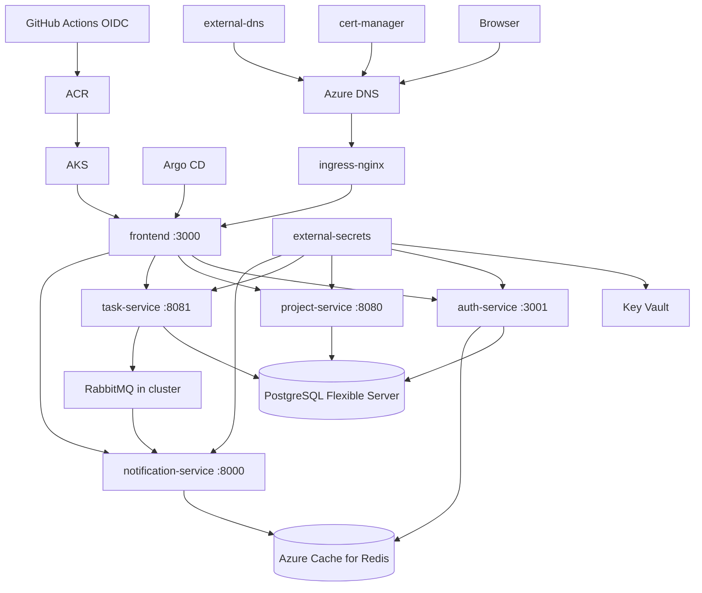

# TaskFlow architecture

## Application

The three database nodes represent service-owned schemas in one local PostgreSQL instance. Services do not query each other's tables. The Next.js API layer is a small browser-facing proxy, not a separate gateway deployment. Its explicit route allowlist keeps private service URLs and credentials outside the browser.

### Request flow

1. A sign-in request reaches auth through the frontend. Auth verifies a salted scrypt password hash and creates a random, 24-hour Redis session. Redis stores only a hash of the opaque bearer token as the key.
2. The frontend stores the token in an httpOnly, SameSite=Lax cookie and returns the public user. Mutating browser requests must have a matching origin. Local HTTP cookies are not marked Secure; set the frontend option when adding HTTPS.
3. Projects validate the token with auth and scope all repository operations to that owner. Tasks resolve project access through the project service before returning or changing records.
4. Registration stores a salted password hash. Login and registration issue a signed JWT whose session remains revocable through Redis; legacy Milestone 1 opaque sessions remain valid until expiry.
5. Project owners manage membership snapshots after the auth service resolves an existing account. Owners and members can collaborate; only owners manage project details, members, and archival.
6. Each task write and its notification events commit in one PostgreSQL transaction. An outbox worker publishes persistent messages to RabbitMQ with publisher confirmations and retries stable event IDs after dependency outages or restarts.
7. The notification service acknowledges a RabbitMQ message only after Redis atomically deduplicates its event ID and prepends it to the recipient's capped feed. The user's feed API validates their session with auth.

### Operational boundaries

Each app runs one foreground process per container with a non-root identity, minimal runtime artifact set, configuration from the environment, and shutdown handling. Go ships a compiled executable; Java ships its application JAR on a JRE; the frontend ships Next.js standalone output; auth ships compiled JavaScript and production packages; notifications ship Python and installed runtime packages. Build tools and tests stay in build stages.

`/health` answers whether the process can respond. `/ready` also probes required dependencies; Docker healthchecks use readiness. Startup ordering reduces dependency races; timeouts and safe error responses handle later failures. Compose restarts crashed processes, but does not restart merely unhealthy containers. Investigate logs rather than assuming a green process means its dependencies work.

The local network is private to Compose by default. The frontend, PostgreSQL development port, and RabbitMQ management console are loopback-only; Redis and the AMQP port are not published. All schemas share one database role in this local stack. Accounts are created by registration. An optional bootstrap account is controlled by DEMO_EMAIL and DEMO_PASSWORD. Local HTTP is a development choice.

## Platform

AKS uses Azure CNI. Node and pod traffic leaves through a NAT gateway. Only the frontend is published, on the nginx ingress, with a cert-manager certificate. The other four services are ClusterIP.

PostgreSQL and Redis are optional Azure managed services on private endpoints. RabbitMQ stays in the cluster because Azure has no drop-in managed AMQP broker that matches the existing URL. The choice is recorded in [ADR 0003](ADR/0003-data-services.md).

GitHub Actions authenticates with a federated credential. There is no client secret. Argo CD deploys `helm/taskflow` from this repository. Production rollouts bump image tags in `values-production.yaml` after the `production` environment approval gate.
