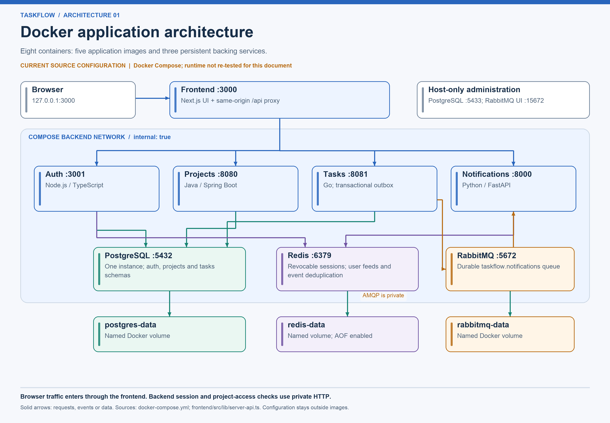
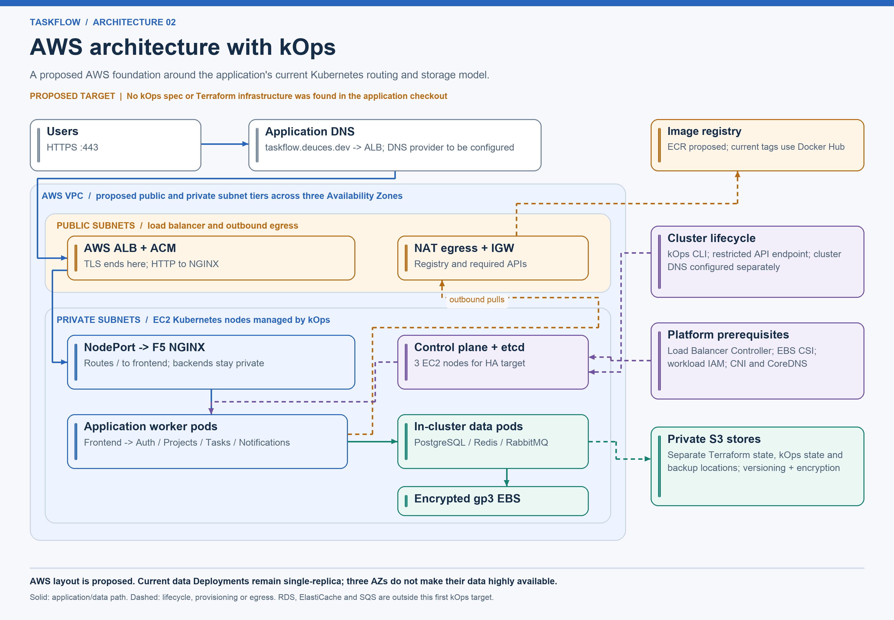
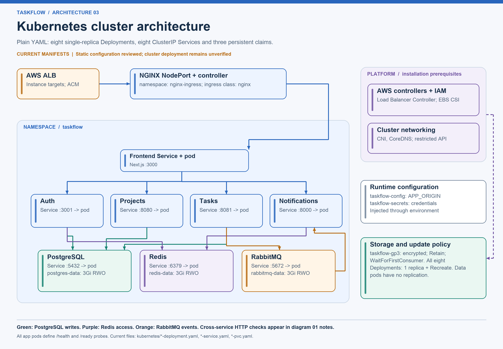
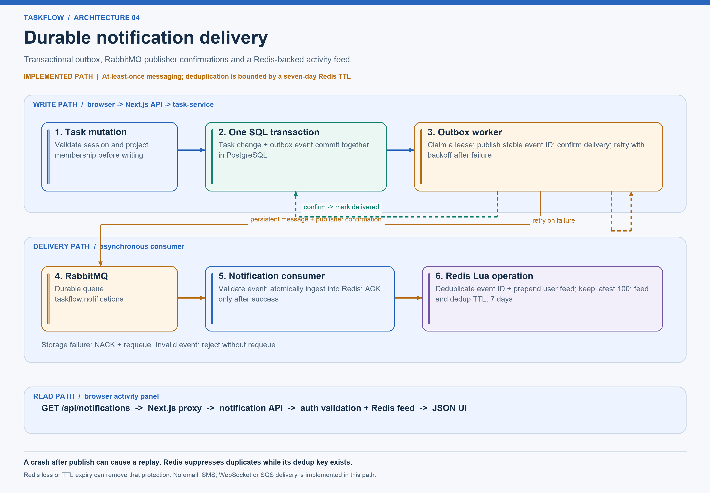
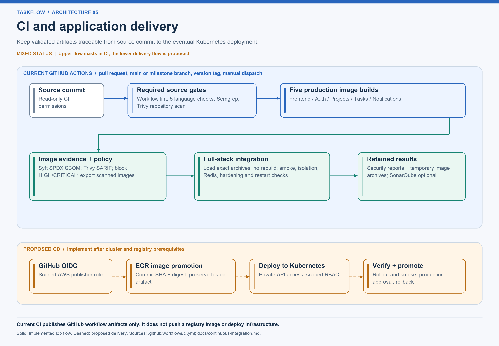
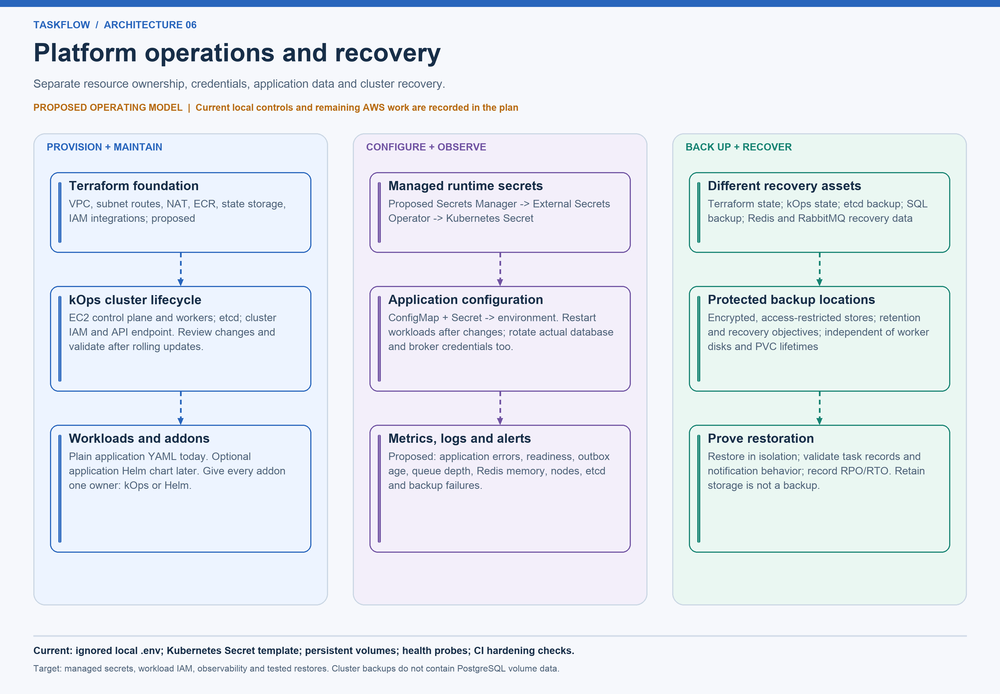

# TaskFlow architecture gallery

[Documentation index](../README.md) · [Implementation plan](../plans/implementation-plan.md) · [Evidence](source-map.md)

The diagrams describe the inspected application source and the proposed AWS extension. They do not certify a deployed environment. Blue identifies application traffic, green persistence, purple session/configuration/platform concerns, and orange messaging or delivery work. Individual captions explain line styles.

## 1. Docker application architecture

[PNG](01-docker-architecture.png) · [SVG](01-docker-architecture.svg) · [Mermaid](sources/01-docker-architecture.mmd)

Five custom images run the frontend, auth, projects, tasks and notifications. The browser talks only to Next.js on loopback port 3000 by default. Its server-side API proxy forwards to private backend URLs; session tokens remain out of browser JavaScript. The backend Compose network is internal. Frontend, PostgreSQL and RabbitMQ also join the ingress network; PostgreSQL's development port and the RabbitMQ console are loopback-only.

Auth, projects and tasks own separate schemas in one PostgreSQL instance. Auth stores revocable sessions in Redis; notifications store feeds and deduplication keys there. Tasks publish to RabbitMQ through a transactional outbox, and notifications consume that queue. PostgreSQL, Redis and RabbitMQ each persist in a named Docker volume. Redis has AOF enabled; the current local Redis configuration has no password or TLS.

Private HTTP dependencies are omitted from the picture to keep it readable: projects, tasks and notifications validate sessions through auth; tasks also check project membership through projects. Every app exposes `/health` and `/ready`.

## 2. Proposed AWS architecture with kOps

[PNG](02-aws-kops-architecture.png) · [SVG](02-aws-kops-architecture.svg) · [Mermaid](sources/02-aws-kops-architecture.mmd)

Application DNS points to a public ALB. ACM terminates HTTPS there; ALB instance targets forward HTTP to the F5 NGINX NodePort Service. NGINX routes to the frontend, which retains the private API proxy. This follows the routing templates already in the repository. Backend application ports and data ports stay private.

The VPC subnet tiers, NAT egress, ECR migration, private nodes and three-control-plane HA topology are **proposed**. The first AWS deployment retains the current three in-cluster data workloads with encrypted EBS volumes. Three AZs do not replicate those single-instance databases or the broker. Region, CIDRs, instance types, capacity and availability profile must be chosen before provisioning.

Terraform owns the foundation, kOps owns cluster lifecycle, and Kubernetes controllers own reconciled load balancers and volumes. Public application DNS and the restricted Kubernetes API endpoint are different endpoints. Keep private state stores separate from any public OIDC discovery assets. See the [AWS plan](../plans/aws/README.md).

## 3. Kubernetes cluster architecture

[PNG](03-kubernetes-cluster.png) · [SVG](03-kubernetes-cluster.svg) · [Mermaid](sources/03-kubernetes-cluster.mmd)

The current `kubernetes/` folder defines **eight Deployments and eight ClusterIP Services**, all in `taskflow`. Every Deployment has one replica and uses `Recreate`. PostgreSQL, Redis and RabbitMQ mount standalone 3Gi ReadWriteOnce claims using `taskflow-gp3`. The StorageClass requests encryption, delayed binding, volume expansion and `Retain`.

`frontend-ingress` uses class `nginx`. The separate ALB example lives in `nginx-ingress`, uses class `alb`, and targets `taskflow-nginx-nginx-ingress-controller`. The two controllers, EBS CSI and their IAM access are prerequisites. The Secret and ALB examples require configuration and explicit application; a folder-wide apply does not apply `.example` files.

This replaces the older images' StatefulSet and `default` StorageClass descriptions. Existing bound claims cannot be switched to another StorageClass in place. If migrating an existing installation, follow the application's migration notes and back up data first. See the [Kubernetes plan](../plans/kubernetes/README.md).

## 4. Durable notification delivery

[PNG](04-notification-delivery.png) · [SVG](04-notification-delivery.svg) · [Mermaid](sources/04-notification-delivery.mmd)

A task mutation and its outbox event commit together. A leased worker publishes persistent messages to the durable queue, waits for publisher confirmation, then marks delivery. Failed attempts retry with a stable event ID and bounded exponential backoff. A crash after publishing can replay a message.

The consumer validates messages, then uses one Redis Lua operation for deduplication and feed insertion. It acknowledges after successful ingestion, requeues storage failures and rejects invalid events without requeue. Redis retains up to 100 feed entries; feed and deduplication keys expire after seven days. Idempotence therefore depends on retained Redis keys. This is at-least-once delivery with bounded deduplication, not a guarantee of exactly-once processing. The UI reads JSON through the notification API; email and push delivery are not implemented.

## 5. CI and proposed application delivery

[PNG](05-delivery-pipeline.png) · [SVG](05-delivery-pipeline.svg) · [Mermaid](sources/05-delivery-pipeline.mmd)

Current required gates cover workflow lint, five service checks, Semgrep and Trivy repository scanning. Five image jobs create SPDX SBOMs and SARIF reports and block HIGH/CRITICAL findings. Integration loads those exact image archives and checks behavior, isolation, notification ingestion, hardening and restart behavior. The repository scan waits for the Java job so Maven dependency information is available. SonarQube is optional and is outside the required image-build dependencies.

The current workflow does not push registry images or deploy. The lower diagram row is the proposed extension: scoped GitHub OIDC, ECR promotion, cluster access, rollout verification and controlled production promotion. See the [CI/CD plan](../plans/cicd/README.md).

## 6. Operations and recovery

[PNG](06-platform-operations.png) · [SVG](06-platform-operations.svg) · [Mermaid](sources/06-platform-operations.mmd)

The proposed operating model separates infrastructure ownership, runtime secrets, monitoring and recovery assets. Managed secrets, External Secrets Operator, production observability and restore automation remain future work. Current safeguards include local ignored configuration, container restrictions, health probes, persistent volumes and CI checks.

Terraform state, kOps state, etcd backups and application-volume backups restore different things. A retained EBS volume is not an independent backup. Redis stores revocable sessions and notification feeds, so losing it has visible user effects. See the [operations plan](../plans/operations/README.md).
