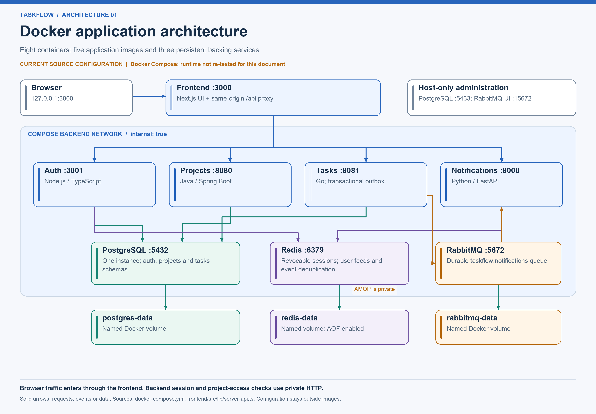
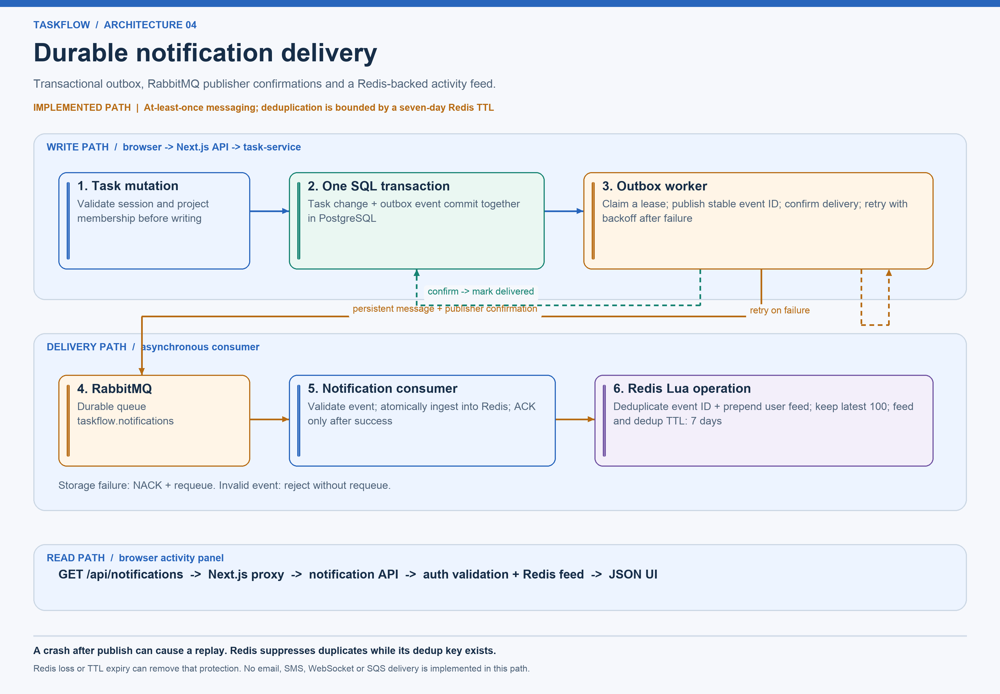

# TaskFlow architecture diagrams

[Documentation index](../README.md) · [Application architecture](../architecture.md)

These diagrams describe the local Docker Compose application. Blue is application traffic, green is persistence, purple is session and configuration data, and orange is messaging.

## Docker application architecture

[PNG](01-docker-architecture.png) · [SVG](01-docker-architecture.svg) · [Mermaid](sources/01-docker-architecture.mmd)

Five custom images run the frontend, auth, projects, tasks, and notifications. The browser talks only to Next.js on loopback port 3000 by default. Its server-side API proxy forwards to private backend URLs; session tokens remain out of browser JavaScript. The backend Compose network is internal. Frontend, PostgreSQL, and RabbitMQ also join the ingress network; PostgreSQL's development port and the RabbitMQ console are loopback-only.

Auth, projects, and tasks own separate schemas in one PostgreSQL instance. Auth stores revocable sessions in Redis; notifications store feeds and deduplication keys there. Tasks publish to RabbitMQ through a transactional outbox, and notifications consume that queue. PostgreSQL, Redis, and RabbitMQ each persist in a named Docker volume. Redis has AOF enabled.

Private HTTP dependencies are omitted from the picture to keep it readable: projects, tasks, and notifications validate sessions through auth; tasks also check project membership through projects. Every app exposes `/health` and `/ready`.

## Durable notification delivery

[PNG](04-notification-delivery.png) · [SVG](04-notification-delivery.svg) · [Mermaid](sources/04-notification-delivery.mmd)

A task mutation and its outbox event commit together. A leased worker publishes persistent messages to the durable queue, waits for publisher confirmation, then marks delivery. Failed attempts retry with a stable event ID and bounded exponential backoff. A crash after publishing can replay a message.

The consumer validates messages, then uses one Redis Lua operation for deduplication and feed insertion. It acknowledges after successful ingestion, requeues storage failures, and rejects invalid events without requeue. Redis retains up to 100 feed entries; feed and deduplication keys expire after seven days. Idempotence therefore depends on retained Redis keys. This is at-least-once delivery with bounded deduplication. The UI reads JSON through the notification API.

Regenerate the SVG and PNG files with `python3 docs/architecture/sources/render_diagrams.py` (Pillow and DejaVu Sans or Arial).
